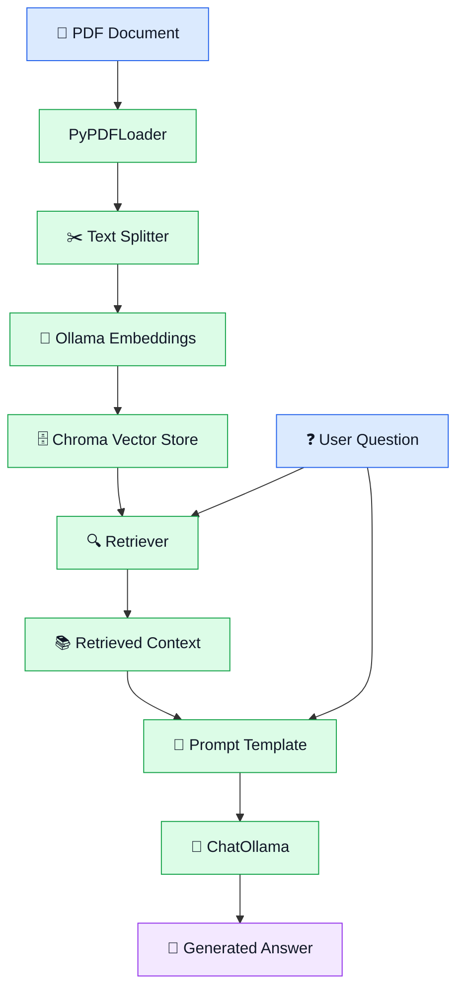
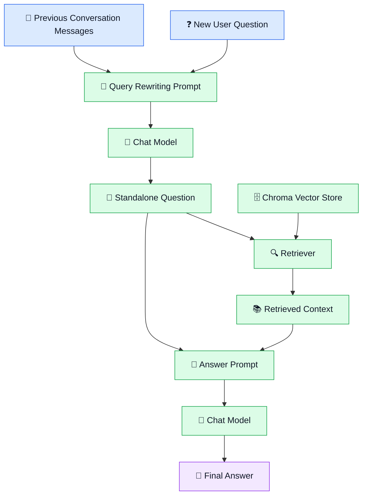
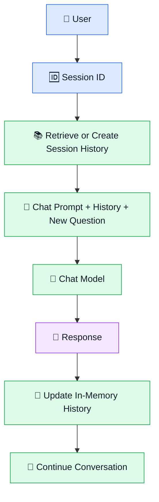

<div align="center">


<a href="https://git.io/typing-svg">
  
</a>

<br/>

<p>
  
  
  
  
  
</p>

<p>
  
  
  
  
</p>

<p>
  <b>A hands-on Python project exploring document-based question answering,<br/>
  interactive RAG, query rewriting, and session-based chat history.</b>
</p>

<p>
  <a href="#-about-the-project">About</a> •
  <a href="#-the-four-implementations">Implementations</a> •
  <a href="#-project-architecture">Architecture</a> •
  <a href="#%EF%B8%8F-installation-and-setup">Setup</a> •
  <a href="#%EF%B8%8F-how-to-run">Run</a> •
  <a href="#-future-improvements">Roadmap</a>
</p>

</div>

---

## 📌 Table of Contents

<details open>
<summary><b>Click to expand / collapse</b></summary>

- [📖 About the Project](#-about-the-project)
- [🎯 Project Objectives](#-project-objectives)
- [🧰 Technologies Used](#-technologies-used)
- [✨ Project Features](#-project-features)
- [📂 Project Structure](#-project-structure)
- [🏗️ Project Architecture](#️-project-architecture)
- [🧩 The Four Implementations](#-the-four-implementations)
- [⚙️ Installation and Setup](#️-installation-and-setup)
- [▶️ How to Run](#️-how-to-run)
- [💬 Example Interaction](#-example-interaction)
- [🧠 Understanding the Concepts](#-understanding-the-concepts)
- [⚠️ Current Limitations](#️-current-limitations)
- [🔮 Future Improvements](#-future-improvements)
- [👨‍💻 Author](#-author)

</details>

---

## 📖 About the Project

This repository contains **four Python implementations** built while learning **Retrieval-Augmented Generation (RAG)** and conversational applications using **LangChain** and **Ollama**.

It starts with a basic document-question-answering pipeline and gradually adds interactive question answering, query rewriting using conversation history, and session-based chat history management.

Instead of relying entirely on a language model's built-in knowledge, the RAG implementations **retrieve relevant text chunks from a PDF** and give that content to the model as context.

### 💡 What does this project do?

| | Capability |
|---|---|
| 📄 | Loads content from a PDF document |
| ✂️ | Splits document content into smaller text chunks |
| 🧬 | Generates embeddings for document chunks |
| 🗄️ | Stores document representations in a Chroma vector store |
| 🔍 | Retrieves relevant chunks for a question |
| 🤖 | Uses an Ollama language model to generate a response |
| 🔄 | Supports repeated question answering in an interactive program |
| 🧠 | Rewrites follow-up questions using conversation history |
| 💬 | Demonstrates session-based message history |

---

## 🎯 Project Objectives

The primary goal is to understand **how individual RAG components work together** and how extra functionality can be layered on top of a basic retrieval pipeline.

| Objective | Description |
|:--|:--|
| 📄 **Document loading** | Read PDF content using a document loader |
| ✂️ **Text splitting** | Divide documents into smaller chunks for retrieval |
| 🧬 **Embeddings** | Convert text into vector representations |
| 🗄️ **Vector storage** | Store and retrieve document representations using Chroma |
| 🔍 **Retrieval** | Find relevant chunks for a user's question |
| 🤖 **Answer generation** | Generate responses using retrieved context |
| 🔄 **Interactive RAG** | Ask multiple questions in one running program |
| 📝 **Query rewriting** | Rewrite a follow-up question using previous conversation messages |
| 💬 **Session history** | Maintain separate in-memory message histories by session ID |

---

## 🧰 Technologies Used

<div align="center">


</div>

<br/>

| Technology | Purpose in this project |
|:--|:--|
| 🐍 **Python** | Implements application logic and connects the RAG components |
| 🦜 **LangChain** | Connects loaders, splitters, prompts, models, retrievers, and chains |
| 📄 `PyPDFLoader` | Loads document content from PDF files |
| ✂️ `RecursiveCharacterTextSplitter` | Splits loaded content into smaller chunks |
| 🧬 `OllamaEmbeddings` | Generates embeddings using an Ollama embedding model |
| 🗄️ `Chroma` | Stores vectors and supports similarity-based retrieval |
| 🤖 `ChatOllama` | Connects the app to chat models served through Ollama |
| 📝 `ChatPromptTemplate` | Defines prompts for answering and query rewriting |
| 🔤 `StrOutputParser` | Converts model output into a string |
| 🧩 `MessagesPlaceholder` | Provides a slot for conversation messages inside a chat prompt |
| 💾 `InMemoryChatMessageHistory` | Stores chat messages in memory for a session |
| 🔗 `RunnableWithMessageHistory` | Wraps a chain with session-based message-history handling |

### 🤖 Models used

| Model | Role |
|:--|:--|
| `nomic-embed-text` | Document embeddings in the RAG implementations |
| `qwen2.5-coder:3b` | Chat model in the RAG implementations |
| `gpt-oss:120b-cloud` | Chat model in the session-history implementation |

> 📝 Model availability and execution depend on your Ollama environment and the model tags configured in the code.

---

## ✨ Project Features

<table>
<tr>
<td width="50%" valign="top">

### 📄 1. PDF-Based Q&A
Load a PDF and ask questions about its contents. Relevant chunks are retrieved and passed to the model as context.

</td>
<td width="50%" valign="top">

### 🔍 2. Semantic Retrieval
Chunks are embedded and stored in Chroma. The retriever finds relevant chunks instead of sending the whole document every time.

</td>
</tr>
<tr>
<td width="50%" valign="top">

### 🔄 3. Interactive Q&A
A loop accepts multiple questions until the user chooses to exit.

</td>
<td width="50%" valign="top">

### 📝 4. Query Rewriting
Previous messages plus a new question produce a standalone question *before* retrieval.

</td>
</tr>
<tr>
<td colspan="2" valign="top">

### 💬 5. Session-Based Chat History
A separate in-memory history is kept for each session ID, so messages stay tied to their own conversation.

</td>
</tr>
</table>

---

## 📂 Project Structure

```text
RAG/
│
├── projects/
│   ├── basic_rag.py                  # 1️⃣ Basic RAG pipeline
│   ├── basic_rag_interactive.py      # 2️⃣ Interactive question loop
│   ├── rag_with_query_rewriting.py   # 3️⃣ History-aware query rewriting
│   └── session_chat_history.py       # 4️⃣ Session-based chat history
│
├── README.md
└── requirements.txt
```

> 📌 **Note:** The filenames above are the recommended names for the four existing programs. Rename your files accordingly if you haven't already, and keep `README.md` and `requirements.txt` in the repository root if that matches your layout.

### 📁 File descriptions

| File | Purpose |
|:--|:--|
| `basic_rag.py` | Basic PDF-based RAG pipeline for answering a question |
| `basic_rag_interactive.py` | Basic implementation plus an interactive question loop |
| `rag_with_query_rewriting.py` | Uses conversation history to rewrite a question before retrieval |
| `session_chat_history.py` | Demonstrates session-based chat history with in-memory storage |
| `README.md` | Project documentation |
| `requirements.txt` | Python dependencies |

---

## 🏗️ Project Architecture

### 🔹 Basic RAG workflow



### 🔹 Query rewriting workflow



> ⚠️ **Important distinction:** In the query-rewriting implementation, conversation history is used to rewrite the question **before retrieval**. The final answer prompt receives the standalone question and retrieved context — the entire conversation history is **not** passed directly into that final prompt.

### 🔹 Session-history workflow



> 💾 The session-history program stores messages **in memory only**. It does not implement permanent, database-backed conversation storage.

---

## 🧩 The Four Implementations

<div align="center">

| Level | File | Adds |
|:-:|:--|:--|
| 1️⃣ | `basic_rag.py` | Core RAG pipeline |
| 2️⃣ | `basic_rag_interactive.py` | Question loop |
| 3️⃣ | `rag_with_query_rewriting.py` | History-aware retrieval |
| 4️⃣ | `session_chat_history.py` | Per-session memory |

</div>

<details>
<summary><h3>1️⃣ Basic RAG — <code>basic_rag.py</code></h3></summary>

**🎯 Purpose:** Understand the fundamental Retrieval-Augmented Generation workflow.

The program loads a PDF, splits it into chunks, creates embeddings, stores them in Chroma, retrieves relevant chunks, and passes the retrieved context to a chat model.

**Workflow**

1. Load the PDF with `PyPDFLoader`
2. Split content with `RecursiveCharacterTextSplitter`
3. Generate embeddings using `OllamaEmbeddings`
4. Add the document chunks to Chroma
5. Retrieve the most relevant chunks for a question
6. Combine the retrieved text into a context
7. Pass the context and question to the prompt template
8. Generate and display the answer using `ChatOllama`

**⚙️ Current configuration**

| Setting | Value |
|:--|:--|
| Chunk size | `200` |
| Chunk overlap | `20` |
| Retrieved chunks (`k`) | `3` |
| Embedding model | `nomic-embed-text` |
| Chat model | `qwen2.5-coder:3b` |

> These values describe the current implementation and can be changed in the Python file.

</details>

<details>
<summary><h3>2️⃣ Interactive RAG — <code>basic_rag_interactive.py</code></h3></summary>

**🎯 Purpose:** Ask multiple questions without restarting the app after every question.

This implementation adds a loop around the RAG question-answering process.

**Workflow**

1. Initialize the PDF retrieval pipeline
2. Display the available menu options
3. Accept a question from the user
4. Retrieve relevant chunks
5. Generate an answer using the model
6. Continue accepting questions until the user selects exit

**What it demonstrates**

- 🔁 Python `while` loops
- ⌨️ User input handling
- 🔍 Repeated retrieval and answer generation
- 🖥️ Basic command-line interaction

> ⚠️ The current implementation does **not** automatically make previous questions part of the next question's context.

</details>

<details>
<summary><h3>3️⃣ RAG with Query Rewriting — <code>rag_with_query_rewriting.py</code></h3></summary>

**🎯 Purpose:** Improve retrieval for follow-up questions that depend on earlier messages.

A follow-up like *"What about its advantages?"* or *"Explain that in more detail."* is hard to retrieve against a document because it depends on context. Query rewriting uses previous messages and the new question to create a **self-contained question** before retrieval.

**Workflow**

1. Maintain a list of conversation messages
2. Receive a new user question
3. Pass previous messages and the new question to a rewriting prompt
4. Generate a standalone question
5. Retrieve document chunks using the rewritten question
6. Pass the retrieved context and standalone question to the answer prompt
7. Generate the answer
8. Append the new question and answer to the conversation history

**What it demonstrates**

- 🔄 Conversation-aware question rewriting
- 🧭 Using history to improve the retrieval query
- 🧱 Separating query rewriting from answer generation
- 📋 Maintaining a simple history with Python data structures

> ⚠️ **Current limitation:** History is a Python list of tuples that exists only while the program runs. This implementation does not use the session-history wrapper from the fourth program.

</details>

<details>
<summary><h3>4️⃣ Session-Based Chat History — <code>session_chat_history.py</code></h3></summary>

**🎯 Purpose:** Understand how a chat chain can load and update message history for a specific session.

This program uses `InMemoryChatMessageHistory` and `RunnableWithMessageHistory` to associate messages with a session ID.

**Workflow**

1. Receive a session ID
2. Check whether a history object already exists for that session
3. Create an in-memory history object if the session is new
4. Invoke the chat chain with the question and session configuration
5. Load the appropriate message history
6. Generate the response
7. Update the history with the conversation messages
8. Let the user continue the session or open another one

**🔑 Important components**

| Component | Role |
|:--|:--|
| `InMemoryChatMessageHistory` | Holds messages in RAM |
| `RunnableWithMessageHistory` | Connects the chain to session-specific history |
| `MessagesPlaceholder` | Inserts existing messages into the chat prompt |
| `session_id` | Identifies which conversation's history to use |
| `history_messages_key="history"` | Matches the history key used by the prompt placeholder |
| `input_messages_key="question"` | Identifies the input question in the chain's input dictionary |

> ⚠️ **Current limitation:** Session histories are not saved permanently — they disappear when the Python process ends. The code also uses LangChain APIs that may emit deprecation warnings in newer versions.

</details>

---

## ⚙️ Installation and Setup

### ✅ Prerequisites

- 🐍 Python installed
- 🦙 [Ollama](https://ollama.com) installed and running
- 🤖 The embedding and chat models required by the script you want to run
- 📄 A PDF document to process
- 📦 The Python dependencies installed in your environment

### Step 1 — Clone the repository

```bash
git clone <YOUR_GITHUB_REPOSITORY_URL>
cd <YOUR_PROJECT_DIRECTORY>
```

### Step 2 — Create a virtual environment *(recommended)*

```bash
python -m venv .venv
```

Activate it:

```bash
# Windows Command Prompt
.venv\Scripts\activate

# Windows PowerShell
.\.venv\Scripts\Activate.ps1
```

### Step 3 — Install the dependencies

```bash
python -m pip install -r requirements.txt
```

> 📌 Make sure `requirements.txt` lists the packages your code actually imports. Don't add unrelated dependencies.

### Step 4 — Prepare the PDF

The RAG scripts rely on a PDF path set in the code. Update it to point to your own document:

```python
pdf_path = r"C:\path\to\your\document.pdf"
```

> Use the variable name that already exists in the relevant script.

### Step 5 — Prepare the Ollama models

```bash
ollama pull nomic-embed-text
```

The chat models depend on the tags used in each script. Verify them in your code and Ollama environment before running.

---

## ▶️ How to Run

Run the Python files from the directory that contains them.

| Program | Command |
|:--|:--|
| 1️⃣ Basic RAG | `python basic_rag.py` |
| 2️⃣ Interactive RAG | `python basic_rag_interactive.py` |
| 3️⃣ Query rewriting | `python rag_with_query_rewriting.py` |
| 4️⃣ Session history | `python session_chat_history.py` |

> If your files haven't been renamed, use their actual current filenames.

---

## 💬 Example Interaction

> The following is **illustrative**. Real answers depend on your PDF content and the model.

```text
========================================
       📚 PDF QUESTION ANSWERING
========================================

Enter your question:
What is machine learning?

🔍 Retrieving relevant document chunks...

🤖 Generating answer...

Answer:
Machine learning is a field of artificial intelligence
that enables systems to learn patterns from data.

========================================
```

**Query-rewriting conversation**

```text
User: What is machine learning?
A:    [Answer based on the retrieved PDF content]

User: What are its applications?

🔄 Query rewriting:
   "What are the applications of machine learning?"

🔍 Retriever:
   Searches for relevant chunks using the rewritten question.

A:    [Answer based on the retrieved PDF content]
```

---

## 🧠 Understanding the Concepts

<details>
<summary><b>🔎 What is RAG?</b></summary>
<br/>

Retrieval-Augmented Generation combines **information retrieval** with **language-model generation**. Instead of answering only from its existing knowledge, the application retrieves relevant information from a supplied document and includes it in the prompt.

</details>

<details>
<summary><b>🧬 What are embeddings?</b></summary>
<br/>

Embeddings are numerical representations of text. They let chunks and user questions be compared in vector space to find relevant content.

</details>

<details>
<summary><b>🗄️ What is a vector store?</b></summary>
<br/>

A vector store holds vector representations plus associated information. This project uses **Chroma** to store document representations and retrieve relevant chunks.

</details>

<details>
<summary><b>🔍 What is a retriever?</b></summary>
<br/>

A retriever searches for relevant document chunks in response to a query. The basic RAG implementations configure it to return **three** chunks.

</details>

<details>
<summary><b>📝 What is query rewriting?</b></summary>
<br/>

Query rewriting converts a new question into a more self-contained one, using earlier messages when available. The rewritten question is then used for retrieval.

</details>

<details>
<summary><b>💬 What is session-based chat history?</b></summary>
<br/>

It associates messages with a particular conversation session. The session ID identifies which history is loaded for the next interaction. In this project it is held **in memory**, not stored permanently.

</details>

---

## ⚠️ Current Limitations

This section describes the limitations of the **existing** implementations rather than claiming features that haven't been built.

- 📄 **PDF path configuration:** The RAG scripts require a valid PDF path in the code.
- 📚 **Document scope:** The RAG implementations work only with the PDF documents loaded by the scripts.
- 🧠 **No shared memory in interactive RAG:** Previous questions aren't carried into the next question's context.
- 💾 **No persistence:** Chat histories live in memory and are lost when the program ends.
- ⚠️ **Deprecation warnings:** Some LangChain APIs used may warn in newer versions.

---

## 🔮 Future Improvements

- [ ] 📁 Accept the PDF path via command-line argument or file picker
- [ ] 🗂️ Support multiple documents and other file types
- [ ] 💾 Persist chat history (SQLite or another database)
- [ ] 🔗 Combine query rewriting with session-based history in one program
- [ ] 📌 Show source page numbers alongside answers
- [ ] 🖥️ Add a simple web UI (Streamlit or Gradio)
- [ ] 🧪 Add basic tests and evaluation of retrieval quality
- [ ] 🔄 Update code to the latest LangChain APIs

---

## 👨‍💻 Author

<div align="center">

**Harsha**

<a href="https://github.com/YOUR_USERNAME">
  
</a>
<a href="https://www.linkedin.com/in/YOUR_LINKEDIN">
  
</a>

<br/><br/>

⭐ **If you found this project helpful, consider giving it a star!** ⭐


</div>
